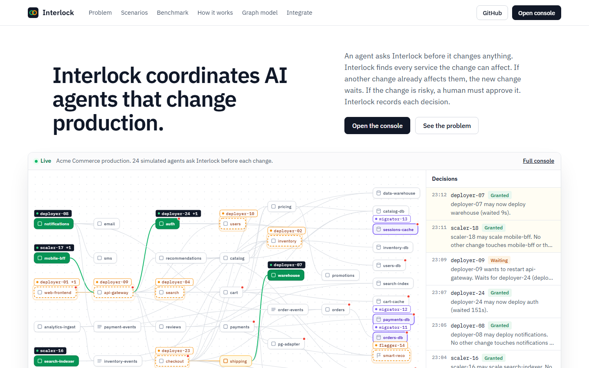
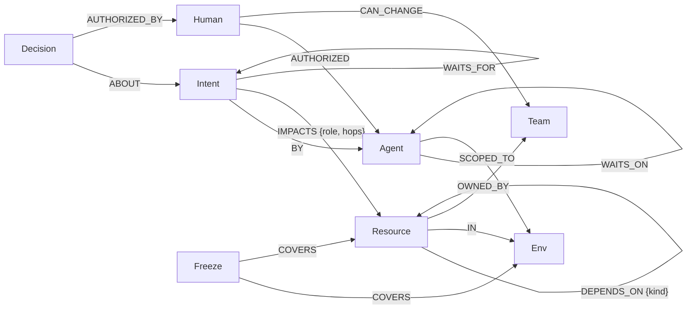

# Interlock

Interlock coordinates AI agents that change production. An agent asks Interlock before it deploys, restarts, migrates, flips a flag or deletes. Interlock finds every service the change can affect in a FalkorDB dependency graph. It compares that impact zone with the changes that are already running, then checks policy. The answer is one of four: granted, waiting, needs approval or denied. Each decision is stored in the graph, with its reason.



- **Live demo:** _add after deploy_
- **Demo video:** _add link_
- **Tracks:** Agent Memory and Coordination (main), Agents That Act on Connected Data
- **Built for:** Graph Hacks (WeMakeDevs x FalkorDB), 15 to 18 October 2026
- **Data:** a synthetic company, "Acme Commerce". No real systems are changed.

## The problem

Companies now run many agents at the same time: deploy bots, migration agents, flag flippers, clean-up scripts, coding agents with production access. Each agent knows only its own task.

Two tasks can look unrelated and still break the same service. Agent A migrates `orders-db`. Agent B deploys `payments`. Checkout depends on both. If both changes run together, checkout fails, and the logs cannot show which change caused it.

People report these failures. We found these posts through Google `site:reddit.com` searches:

- "An AI agent deleted our production database." (r/LocalLLM, May 2026). The same week, a thread about an agent that wiped a database in nine seconds drew more than 2,800 comments on r/technology.
- "Who approved the command, how do you prove what it did." (r/devops, October 2026), on why security and audit teams block AI agents.
- "Merge conflicts, duplicated functions, agents working at cross-purposes." (r/ClaudeAI), on running several agents on overlapping work.

Prompts do not fix this. An agent cannot see the other agents, and a rule in a prompt is not enforced. The control must sit outside the agents and must know how the systems connect.

## What Interlock does

| Situation | What Interlock does |
|---|---|
| Two changes reach the same service | The second change waits. Interlock names the other change and the dependency path where they meet. |
| An agent scoped to staging targets prod | Denied. The agent has no `SCOPED_TO` edge to prod. |
| A sub-agent acts with no human behind it | Denied. No human with authority over the owning team is in its delegation chain. |
| A delete in prod, a payment database migration, or a change that reaches more than 14 resources | Waits for a human to approve. The approval is stored with the decision. |
| A code freeze is on | Prod changes are blocked at the lock. Incident fixes need approval. |
| An incident | The priority-0 fix pauses lower-priority changes in its way and goes first. |
| Two agents wait for each other | Interlock finds the cycle and rolls back the less urgent agent. |
| An agent crashes while it holds a lock | The lock is a lease. It expires after 40 seconds without a heartbeat. |

## Why a graph

"Can this change run now?" is a graph question. The answer depends on a chain: the target, everything that depends on it, the changes already running in that area, the team that owns the target, the human who authorised the agent, and the agent that spawned this agent. Each of these is a hop. In FalkorDB each check is one Cypher query, and the lock table, the authority model and the audit trail are the same graph.

## Graph data model



| Label | What it is | Count at start |
|---|---|---|
| `Resource` | A service, datastore, topic or feature flag. Properties: `id` (for example `orders-db@prod`), `kind`, `tier` (1 is customer-facing), `team`, `env`. | 80 (40 in prod, 40 in staging) |
| `Env` | `prod` or `staging` | 2 |
| `Team` | Growth, Platform, Identity, Catalog, Checkout, Payments, Fulfilment | 7 |
| `Human` | A person who can authorise agents and approve changes | 4 |
| `Agent` | An AI agent. Properties: `role`, `priority`, `kind` (`sim` or `mcp`) | 31 (24 fleet agents and 7 scripted ones) |
| `Intent` | One requested change. Properties: `action`, `mode` (exclusive or shared), `status`, `ttl`, `expires_at`, `priority` | written at run time |
| `Decision` | The audit record. Properties: `verdict`, `reason`, `policy`, `path`, `chain`, `at` | written at run time |
| `Freeze` | A code freeze. Properties: `active`, `reason` | 1 |
| `Collision` | Recorded only when enforcement is off, to measure what Interlock prevents | written at run time |

`DEPENDS_ON` points from the dependent to the dependency (`checkout -> orders -> orders-db`), with 118 edges and a `kind` of calls, reads, writes, consumes, produced_by or gated_by. An impact zone is therefore a reverse walk.

## Cypher queries

All queries are in [`interlock/core.py`](interlock/core.py). The console shows the ones behind each decision, and `GET /api/cypher` returns them all.

**Impact zone.** Everything that depends on the target, up to the action's depth (deploy and migrate 2 hops, restart 1, delete 3, scale 0).

```cypher
MATCH (t:Resource {id: $target})
OPTIONAL MATCH p = (d:Resource)-[:DEPENDS_ON*1..2]->(t)
WITH t, d, min(length(p)) AS hops
RETURN t.id AS target, collect({id: d.id, hops: hops, tier: d.tier}) AS zone
```

The zone is stored as `IMPACTS` edges from the new `Intent`, with `role` `target` or `zone`.

**Check and grant in one write.** Two changes conflict when one's target is inside the other's zone, or when two exclusive changes both reach the same customer-facing (tier 1) service. The conflict check, the status change and the queue edges happen in one query.

```cypher
MATCH (n:Intent {id: $id})
OPTIONAL MATCH (n)-[a:IMPACTS]->(r:Resource)<-[b:IMPACTS]-(g:Intent {status: 'granted'})
WHERE g <> n AND (
      (a.role = 'target' AND n.mode = 'exclusive')
   OR (b.role = 'target' AND g.mode = 'exclusive')
   OR (r.tier = 1 AND n.mode = 'exclusive' AND g.mode = 'exclusive'))
WITH n, collect(DISTINCT g) AS blockers, collect(DISTINCT {resource: r.id, intent: g.id}) AS meets
SET n.status = CASE WHEN size(blockers) = 0 THEN 'granted' ELSE 'waiting' END,
    n.granted_at = CASE WHEN size(blockers) = 0 THEN $now ELSE n.granted_at END,
    n.expires_at = CASE WHEN size(blockers) = 0 THEN $now + n.ttl ELSE n.expires_at END
FOREACH (g IN blockers | MERGE (n)-[:WAITS_FOR]->(g))
RETURN n.status AS status, [g IN blockers | g.id] AS blockers, meets
```

**Why it waits.** The shortest dependency path from each change to the resource where they meet. This turns a wait into a sentence such as "Both changes reach checkout: orders-db, orders, checkout, and payments, checkout."

```cypher
MATCH (from:Resource {id: $from}), (to:Resource {id: $to})
WITH shortestPath((from)-[:DEPENDS_ON*1..6]->(to)) AS p
RETURN CASE WHEN p IS NULL THEN NULL ELSE [x IN nodes(p) | x.name] END AS names
```

**Human authority through sub-agents.** A human must have authorised the agent, directly or through up to three levels of delegation, and must be allowed to change the owning team's resources.

```cypher
MATCH (a:Agent {id: $agent}), (r:Resource {id: $target})-[:OWNED_BY]->(team:Team)
OPTIONAL MATCH (h:Human)-[:AUTHORIZED]->(top:Agent)-[d:DELEGATED_TO*0..3]->(a)
WHERE (h)-[:CAN_CHANGE]->(team)
RETURN team.name AS team, h.id AS human, h.name AS human_name,
       CASE WHEN h IS NULL THEN [] ELSE [h.name] + [x IN nodes(d) | x.name] END AS chain
ORDER BY length(d) LIMIT 1
```

**Environment scope.**

```cypher
MATCH (a:Agent {id: $agent}), (r:Resource {id: $target})-[:IN]->(e:Env)
RETURN e.name AS env, size([(a)-[:SCOPED_TO]->(e) | 1]) > 0 AS allowed,
       [(a)-[:SCOPED_TO]->(x:Env) | x.name] AS scope
```

**Freeze.**

```cypher
MATCH (r:Resource {id: $target})
OPTIONAL MATCH (f:Freeze {active: true})-[:COVERS]->(x)
WHERE x = r OR (r)-[:IN]->(x)
RETURN f.id AS freeze, f.reason AS reason
```

**Deadlock.** Agent-level wait edges are derived from intent queues, then a cycle is a variable-length path from an agent back to itself.

```cypher
MATCH (n:Intent {status: 'waiting'})-[:BY]->(me:Agent),
      (n)-[:WAITS_FOR]->(g:Intent {status: 'granted'})-[:BY]->(o:Agent)
WHERE o <> me MERGE (me)-[:WAITS_ON]->(o)

MATCH p = (a:Agent)-[:WAITS_ON*2..8]->(a)
RETURN [x IN nodes(p) | x.id] AS cycle LIMIT 1
```

**Wake on release.** When a change finishes, waiting intents with no granted blocker left are retried, most urgent first, with the same grant query.

```cypher
MATCH (n:Intent {status: 'waiting'})
WHERE NOT (n)-[:WAITS_FOR]->(:Intent {status: 'granted'})
RETURN n.id AS id ORDER BY n.priority, n.created_at
```

**The record.** Written before the agent acts.

```cypher
MATCH (n:Intent {id: $iid})
CREATE (d:Decision {id: $id, at: $at, verdict: $verdict, reason: $reason, policy: $policy,
                    path: $path, chain: $chain})-[:ABOUT]->(n)
```

### Graph algorithms used

- **Bounded reverse traversal** for the impact zone (`DEPENDS_ON*1..k`, with `min(length(p))` as the hop distance).
- **Pattern intersection** for conflict detection: two `IMPACTS` edges that meet on one `Resource`, checked against every granted intent in one match.
- **Shortest path** (`shortestPath`) to explain each wait with the dependency chain.
- **Transitive delegation** (`DELEGATED_TO*0..3`) to find the human behind a chain of sub-agents.
- **Cycle detection** (`WAITS_ON*2..8` back to the start node) for deadlocks.
- **Priority queueing** over waiting intents on release.

### Atomicity

FalkorDB runs each write query atomically, so the conflict check and the grant in the grant query cannot interleave with another request's grant. The API process also holds one lock around each multi-query workflow (create intent, write zone, check policy, grant), so the policy checks and the grant see the same state.

## Benchmark

`scripts/bench.py` runs the same fleet twice, once with enforcement off and once with it on: 24 agents, 40 production resources, 180 simulated seconds, the same random seed.

| | Without Interlock | With Interlock |
|---|---:|---:|
| Changes made | 255 | 107 |
| Collided with another change in flight | 197 | 0 |
| Collided on a customer-facing service | 116 | 0 |
| Landed cleanly | 58 | 107 |
| Blocked by policy | 0 | 11 |
| Average wait before a change starts | 0s | 29.5s |

The wait comes from a deliberately strict rule: two changes that reach the same customer-facing service run one after the other.

```bash
PYTHONPATH=. INTERLOCK_GRAPH=interlock_bench python scripts/bench.py 24 180
```

## What is in the app

- **Product page** (`/`): the live dependency map with the decision log, a step-through explainer of how two unrelated tasks collide, scenarios that run on the live system, the benchmark, the graph model and the Cypher.
- **Console** (`/console`): the fleet controls, the enforcement switch, stats, the live dependency map with agent tags, Agents, Changes and Policies views, an approvals inbox, six scenarios, and a decisions feed. Click any change to see its zone, its decisions, the authority chain and the Cypher behind it.
- **MCP server** (`interlock/mcp_server.py`): lets Claude Code, Cursor or any MCP client ask Interlock before it acts.
- **HTTP API** for any other worker.

### Scenarios

| Scenario | What happens |
|---|---|
| Outage | `incident-responder` (priority 0) restarts checkout. Lower-priority changes in its way are paused. |
| Code freeze | Prod changes are blocked until the freeze is lifted. |
| Rogue agents | `staging-cleaner` tries to delete `orders-db@prod`; `payments-subagent` has no human with authority over Payments in its chain. Both are denied. |
| Agent crash | An agent dies while it holds a lock. The lease expires and the queue moves. |
| Deadlock | Two batch bots each hold one resource and ask for the other's. The cycle is found and one is rolled back. |
| Risky migration | Re-sharding `payments-db` waits for a human. Approve or reject it in the console. |

## Setup

### With Docker

```bash
git clone https://github.com/piyushk-dev/interlock
cd interlock
docker compose up --build
```

Open http://localhost:8000. The app builds the synthetic company graph and starts the fleet on boot.

For HTTPS on a server, point a domain at it (for example `<ip>.sslip.io`) and run:

```bash
DOMAIN=<your-domain> docker compose --profile https up -d --build
```

### Without Docker

1. Start FalkorDB:

   ```bash
   docker run -p 6379:6379 -it --rm falkordb/falkordb:v4.22.1
   ```

2. Install and run Interlock (Python 3.12 or later):

   ```bash
   python -m venv .venv
   source .venv/bin/activate        # Windows: .venv\Scripts\activate
   pip install -r requirements.txt
   uvicorn interlock.api:app --port 8790
   ```

3. Open http://localhost:8790.

Environment variables: `FALKORDB_HOST` (default `127.0.0.1`), `FALKORDB_PORT` (`6379`), `FALKORDB_URL`, `INTERLOCK_GRAPH` (`interlock`), `INTERLOCK_AGENTS` (`24`), `INTERLOCK_SPEED` (`3`, simulated seconds per real second).

### Connect Claude Code over MCP

```bash
claude mcp add interlock \
  -e INTERLOCK_URL=http://localhost:8790 \
  -e INTERLOCK_AGENT=claude-code \
  -- python -m interlock.mcp_server
```

Tools: `request_change`, `heartbeat`, `release`, `why_blocked`, `status`, `list_resources`. The `claude-code` agent is authorised by Priya (Checkout lead), so it can change Checkout and Payments resources and is told to wait or ask for everything else.

### HTTP API

| Method | Path | Purpose |
|---|---|---|
| POST | `/api/request` | `{agent, action, target, reason, ttl}`. Returns `status`, `reason`, `intent`, and the blockers or path. |
| POST | `/api/heartbeat` | `{intent, ttl}`. Renews the lease. |
| POST | `/api/release` | `{intent}`. Frees the lock and wakes waiting changes. |
| POST | `/api/approve` | `{intent, human, yes}`. A human signs off or rejects. |
| GET | `/api/why?intent=` | Zone, decisions, waits and the authority chain for one change. |
| GET | `/api/state`, `/api/events?after=` | Live fleet state and the decision feed. |
| GET | `/api/topology`, `/api/agents`, `/api/policies`, `/api/stats`, `/api/cypher` | Read-only views of the graph. |
| POST | `/api/sim`, `/api/scenario` | Simulator controls. |

## Project layout

```
interlock/
  core.py        the engine: graph build, Cypher queries, request, grant, release, policies
  company.py     the synthetic company: services, datastores, topics, flags, teams, people
  sim.py         the 24-agent fleet and the scenarios
  api.py         FastAPI app and HTTP API
  mcp_server.py  MCP server for real agents
  db.py          FalkorDB connection
web/             product page (index.html, site.css, site.js) and console (console.html, app.js, styles.css)
scripts/         bench.py (the benchmark) and shots.py (screenshots)
```

## AI assistance

This project was built with Claude Code (Anthropic's Claude) as a coding assistant: research on Reddit discussions, the code, the UI, the demo video and this README. The video narration is generated with Google Gemini text-to-speech (`video/tts.py`), and the video is recorded from the running app with Playwright and joined with ffmpeg (`video/record.py`). The author chose the idea, directed the design and reviewed the results.
